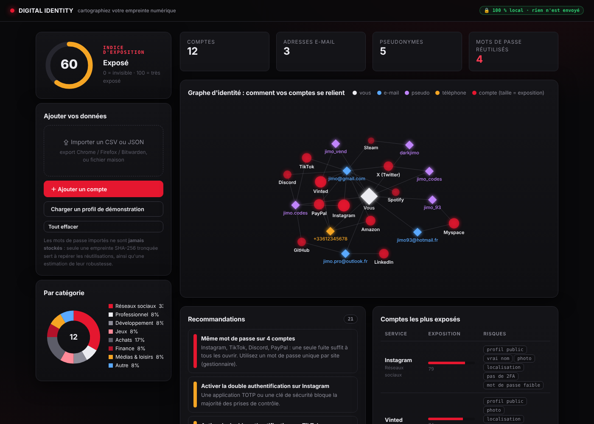

# 🕸 Digital Identity

> Visualisez votre empreinte numérique à partir de vos comptes, pseudonymes et données importées volontairement, puis réduisez-la.

**▶ Fonctionne entièrement dans le navigateur (GitHub Pages)** : aucune donnée n'est envoyée nulle part.



## Ce que l'outil révèle
- **Graphe d'identité** : vous, vos identifiants (e-mails, pseudos, téléphones) et vos comptes. On voit immédiatement quels comptes un inconnu peut relier entre eux.
- **Indice d'exposition** global (0–100) et par compte : profil public, vrai nom, photo, localisation, téléphone lié, absence de 2FA, mot de passe faible, compte dormant.
- **Recommandations priorisées** : mots de passe réutilisés, 2FA à activer, pseudo qui relie trop de comptes, alias e-mail, comptes à supprimer…
- Répartition par catégorie (réseaux sociaux, pro, achats, jeux, finance…).

## Vos données restent chez vous
- Import **CSV** (export des mots de passe de Chrome, Firefox ou Bitwarden) ou **JSON**, ou saisie manuelle.
- Les **mots de passe ne sont jamais stockés** : au moment de l'import, chacun est réduit à une empreinte SHA-256 tronquée (pour repérer les réutilisations) et à une estimation de robustesse en bits. Le texte en clair est aussitôt oublié.
- Persistance optionnelle dans le `localStorage` du navigateur, bouton « Tout effacer ».
- L'outil n'interroge **aucun service tiers** et ne collecte rien sur d'autres personnes : il n'analyse que ce que vous lui donnez sur vous-même.

## Lancer
Ouvrir `index.html`, ou :
```bash
python -m http.server 8000     # → http://localhost:8000
npm test                       # tests de la logique d'analyse (Node ≥ 20)
```
Le bouton **« Charger un profil de démonstration »** remplit l'outil avec un profil fictif.

## Pistes
- Vérification des fuites via l'API *k-anonymity* de Have I Been Pwned (seuls 5 caractères de l'empreinte quittent la machine)
- Import des archives RGPD (Google Takeout, export Instagram) pour lister les données réellement détenues
- Plan de nettoyage pas à pas avec suivi de progression

## Licence
MIT © Jimo0x
